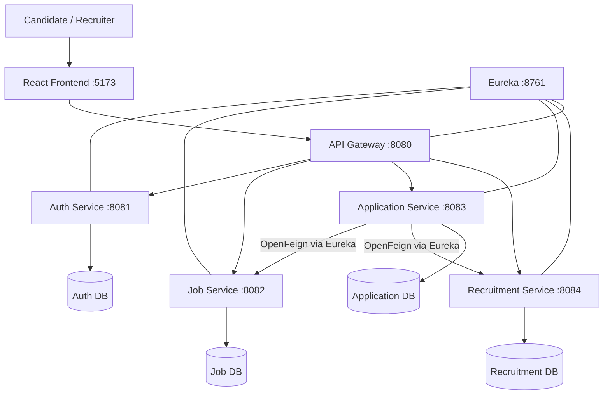
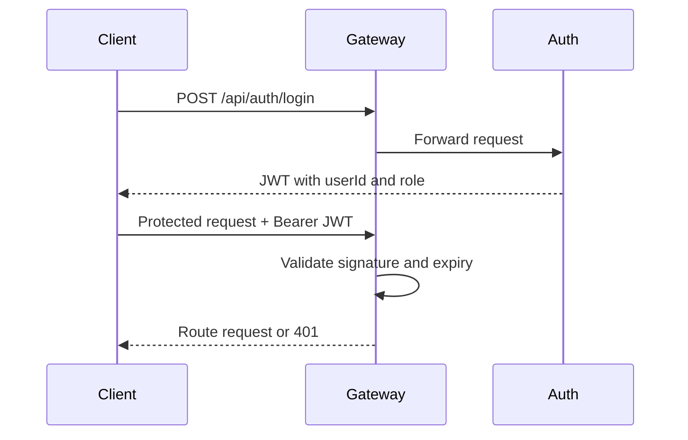
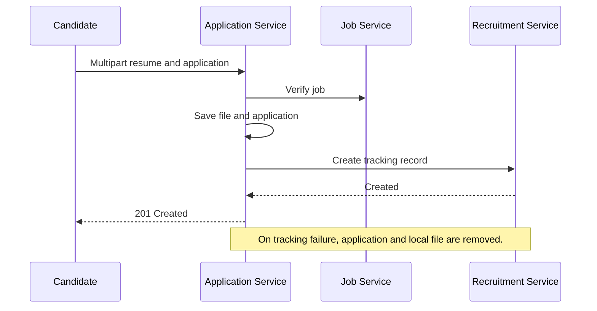

# System Architecture

Each service owns its schema. Application Service stores IDs only, not cross-database JPA relationships. Eureka discovery resolves logical names such as `job-service`; the gateway uses `lb://` routes and Feign uses the registered service name.

